# sky130 Systolic Array MAC: signed 8×8 Processing Element → 4×4 Systolic Array

A transistor-level **multiply-accumulate (MAC) processing element** designed in the open-source **SkyWater sky130** PDK, built up into a **4×4 systolic array**, the same dataflow idea behind Google's TPU.

Designed with **xschem** (schematic), **ngspice** (simulation), and **Magic + netgen** (layout, DRC, LVS) in the IIC-OSIC-TOOLS container.

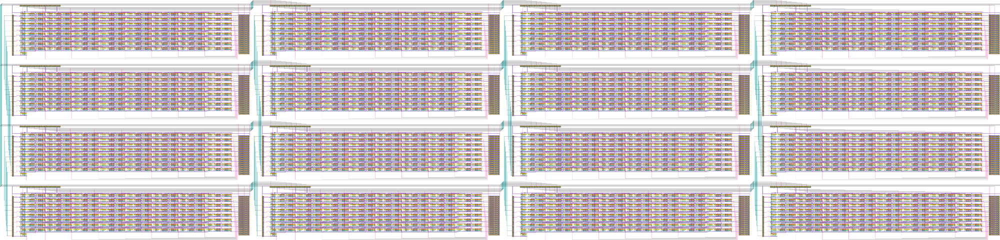

*The full 4×4 array layout, exported straight from Magic (`plot pnm`): 16 MAC processing elements, LVS **1088 = 1088 devices, 2708 = 2708 nets**.*

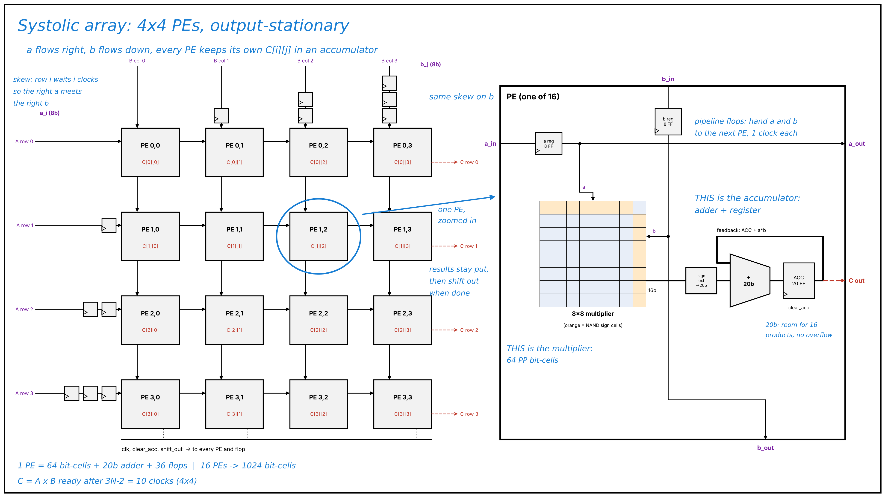

## Key Specifications

| Spec | Value |
|---|---|
| **Process** | SkyWater sky130 (130 nm), 1.8 V |
| **Function** | 4×4 output-stationary systolic array, **C = A·B** |
| **Data width** | signed 8-bit inputs (two's complement), 20-bit accumulators |
| **Multiplier** | 8×8 array, full-custom (34T `pp_cell` + 32T `pp_cell_sign` tiles) |
| **Core size** | **1715.24 × 412.85 µm ≈ 0.71 mm²** |
| **One PE** | ≈ 429 × 104 µm |
| **Full-custom transistors** | 2,152 per PE → **34,432** in the array |
| **Standard cells** | 76 per PE (36 `dfxbp` flops, 20 `fa`, 20 `nor2`) → **1,216** in the array |
| **Throughput** | 16 MACs per clock; a 4×4 result is ready after 3N−2 = **10 clocks** |
| **Simulation** | PE verified in ngspice with a 10 ns clock (−3 × 5 accumulates to −15, −30, −45, −60) |
| **Verification** | LVS: **1088 = 1088 devices, 2708 = 2708 nets** (array), 68 = 68 / 185 = 185 (PE) |
| **Power** | not measured yet |
| **Tools** | xschem · ngspice · Magic VLSI · netgen · IIC-OSIC-TOOLS |

---

## What the PE does

Each clock tick, every PE:

```
ACC[n]   = ACC[n-1] + a·b        (clr = 1 → ACC = a·b, starts a new dot product)
a_out[n] = a[n-1]                (pass a to the right)
b_out[n] = b[n-1]                (pass b down)
```

So after N ticks, `ACC = Σ aₖ·bₖ`, a dot product. Tile 16 of them, feed matrix A in from the left and B from the top in a staircase ("skew"), and every PE ends up holding one element of **C = A·B**.

| Block | What it is | Size |
|---|---|---|
| `mult8` | Signed 8×8 **Baugh-Wooley** array multiplier (`pp_cell` 34T, `pp_cell_sign` 32T) | 2,152 transistors |
| `acc20` | 20-bit accumulator (16-bit product + 4 guard bits), `nor2 + fa + dfxbp` per bit | sky130 std cells |
| `pe_reg` | 8-bit a/b pass-along registers | sky130 std cells |
| `pe_cell` | mult8 + acc20 + pe_reg = one PE | — |
| `array4x4` | 16 PEs, systolic wiring | — |

### The bit-cell at transistor level (xschem)
Every one of the 64 multiplier tiles is this `pp_cell`: an AND for the partial product, then a 28T mirror full adder (carry half + sum half).

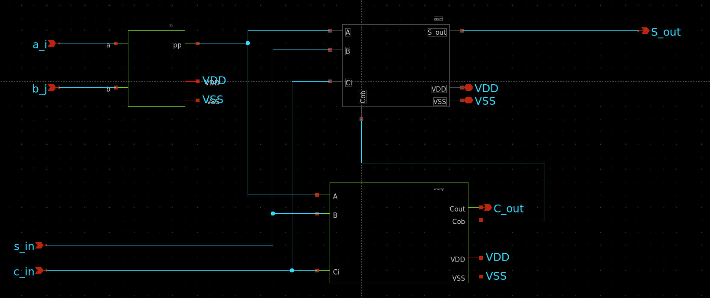

| AND (partial product) | Carry (M7–M18) | Sum (M19–M34) |
|---|---|---|
| 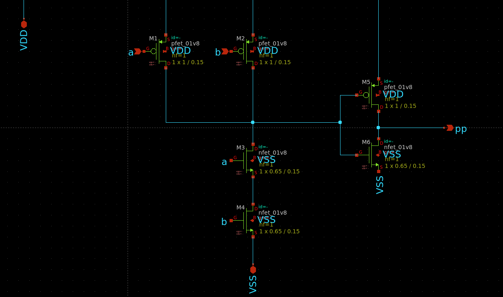 | 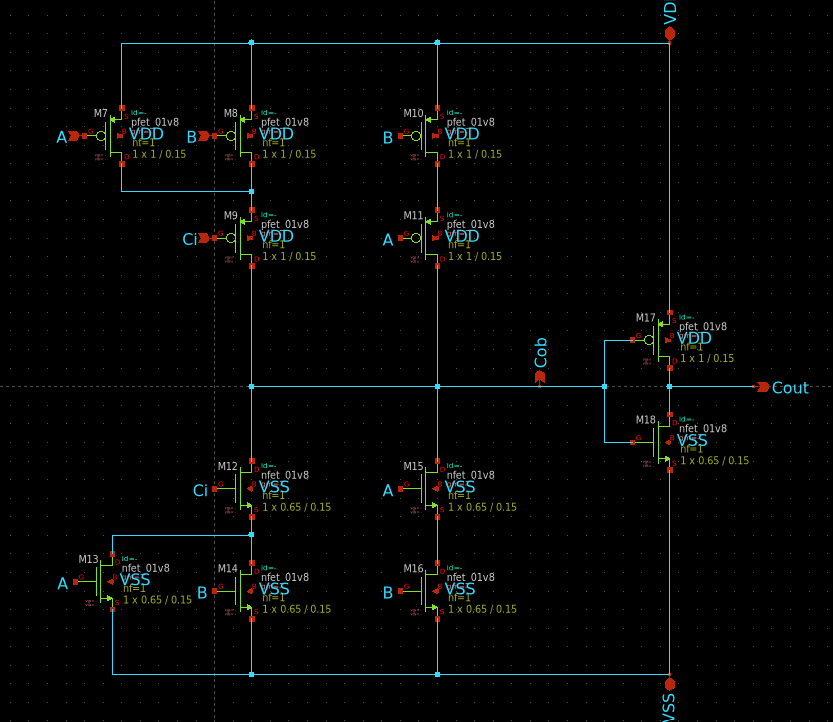 | 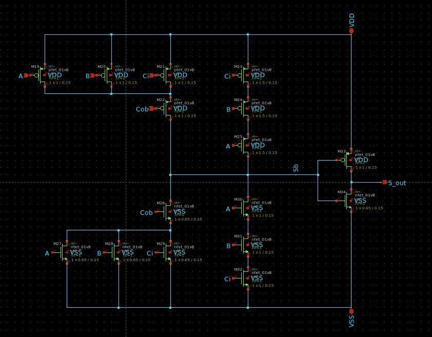 |

---

## Results so far

### ✅ PE cell: simulated and passing
Accumulates −15, −30, −45, −60 over four ticks of (−3 × 5) and passes a/b to its neighbours one tick later.

<p align="center">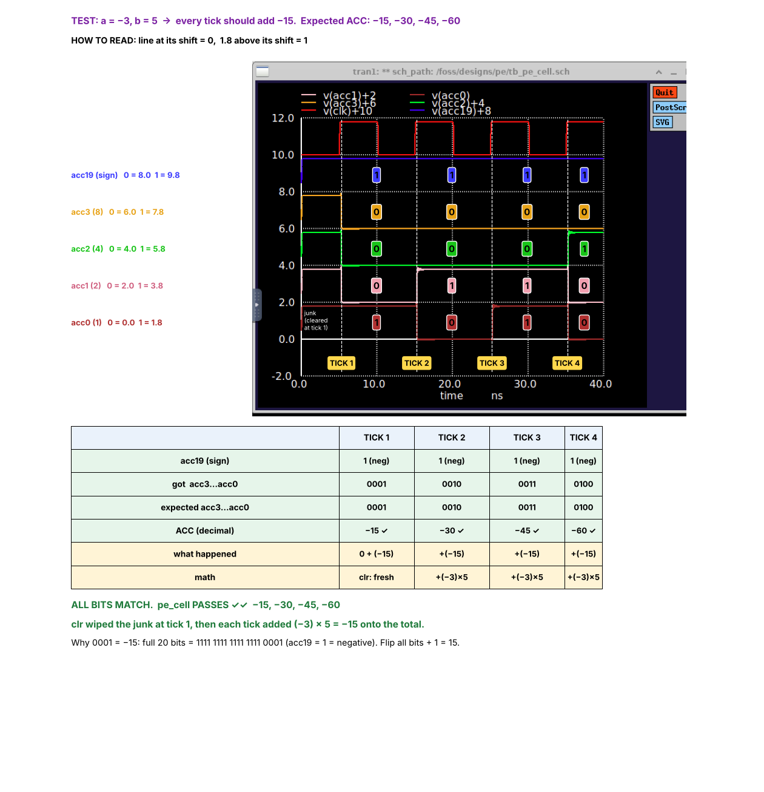</p>

### ✅ Building blocks verified
| | |
|---|---|
| 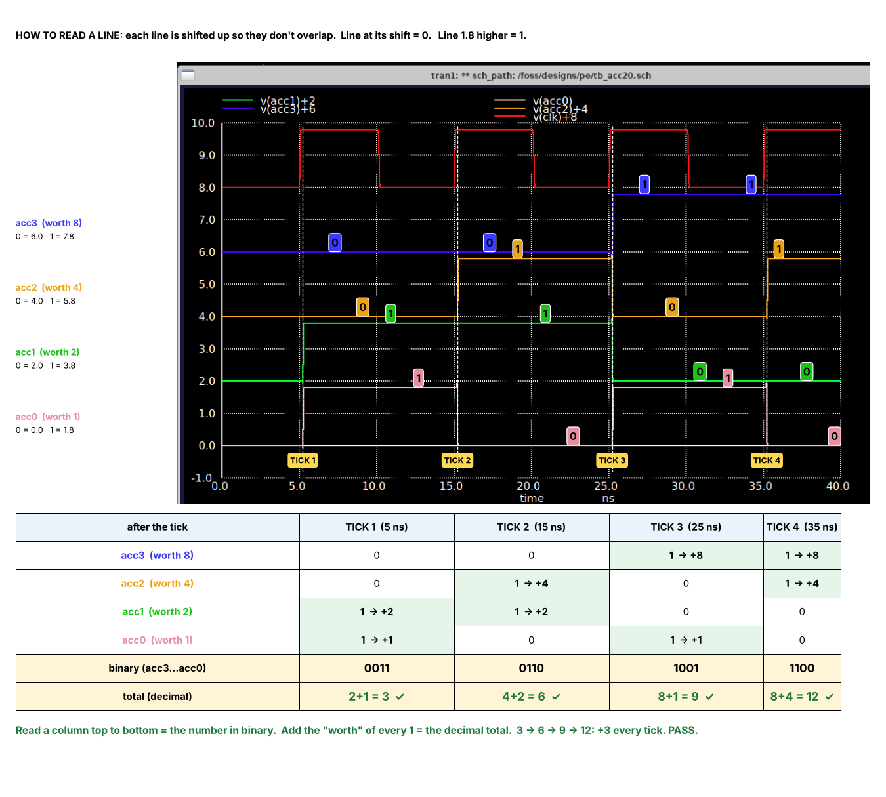 | 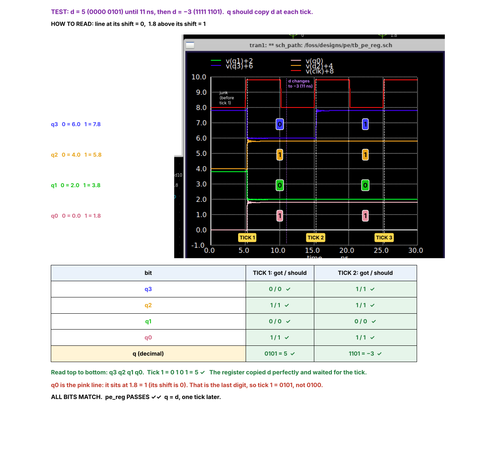 |

### ✅ 4×4 systolic array: schematic + testbench complete
The testbench feeds

```
A = [ 1 -2  3  0 ]    B = [ 2  0  1 -1 ]    C = A·B = [ -3 -3  7 -5 ]
    [ 2  1 -1  4 ]        [ 1  3  0  2 ]              [  6 -6  4 12 ]
    [-3  0  2  1 ]        [-1  1  2  0 ]              [ -8  0  2  6 ]
    [ 1  1  1  1 ]        [ 0 -2  1  3 ]              [  2  2  4  4 ]
```

The input stimulus was generated by script and checked against a behavioural model of the array (`sim/scripts/`).

**Engineering note on scale:** one PE at transistor level takes **~2.7 GB** in ngspice (measured with `rusage`). The full 4×4 needs roughly 40+ GB, more than a laptop has. That's why the industry flow is: **SPICE one cell → behavioural/Verilog for the full array → layout + LVS**. A 2×2 testbench (`C = [[8,-7],[-2,21]]`) is included for a 16 GB machine.

### ✅ Custom layout: DRC clean + LVS match

Every cell is hand-drawn in Magic from a stick diagram (Euler-path gate ordering so each poly line runs straight through both diffusion strips), with n-tap / p-tap for latch-up protection.

| Cell | Transistors | DRC | LVS (netgen) |
|---|---|---|---|
| `and2` (nand2 + inv, front of every `pp_cell`) | 6 | 0 errors | ✅ Circuits match uniquely |
| `carry` (mirror adder carry + inv) | 12 | 0 errors | ✅ Circuits match uniquely |
| `sum` (mirror adder sum + inv) | 16 | 0 errors | ✅ 16 = 16 devices, 14 = 14 nets |
| **`pp_cell` tile** (and2 + carry + sum, abutted) | 34 | 0 errors | ✅ 34 = 34 devices, 23 = 23 nets (see note) |
| `nand2` (pp_and2 with the inverter chopped off, drives P15) | 4 | 0 errors | ✅ 4 = 4 devices, 6 = 6 nets |
| **`mult8`** (8 rows × 8 tiles + nand2) | 2,152 | 0 errors | ✅ **65 = 65 cells, 147 = 147 nets** (pin names: in progress) |

#### and2
| Schematic | Layout (Magic) | LVS |
|---|---|---|
| 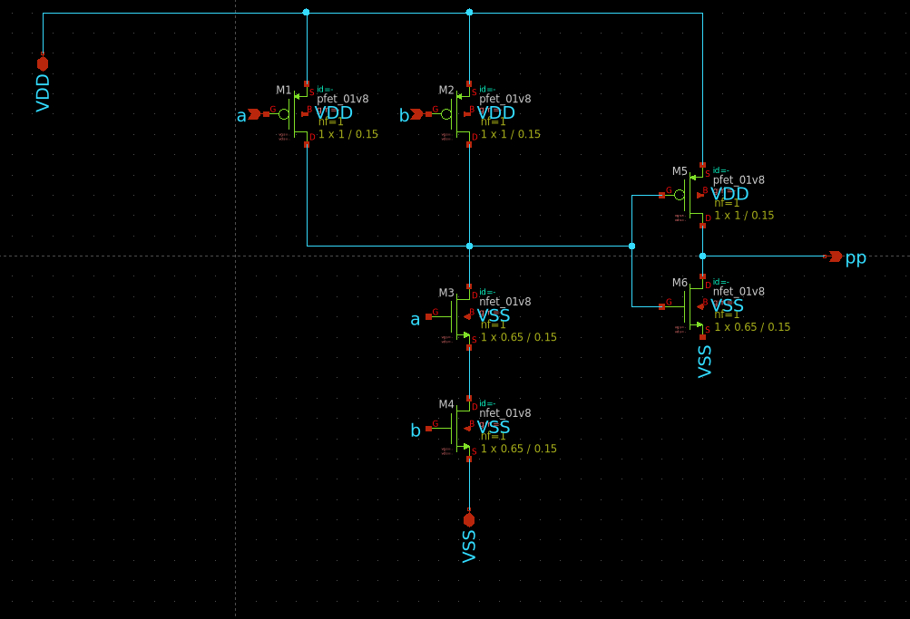 | 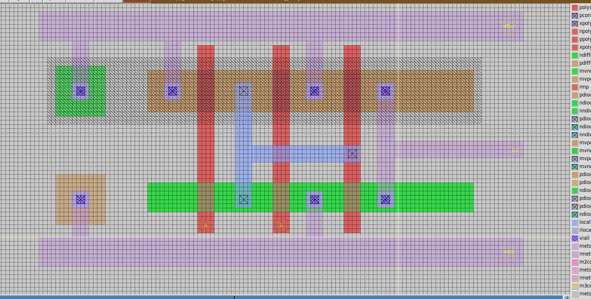 | 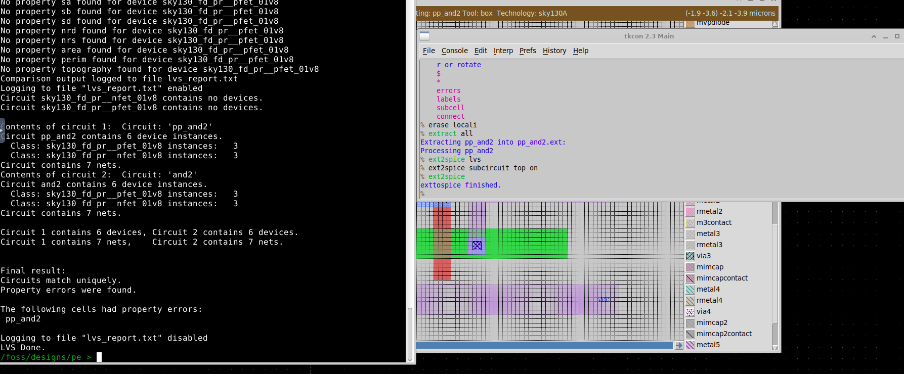 |

#### carry: 28T mirror adder (Weste & Harris Fig. 11.4), carry half
Gate order **A B Ci A B Cob** on both strips. Walking the Euler path exposed that the textbook-style schematic had the PMOS series pair (M10/M11) upside down vs. the NMOS, which would have forced crossing poly. Swapping the two gates fixed it (same logic: series switches AND in either order) and made the pull-up a true mirror of the pull-down.

| Euler path on the schematic | Layout (Magic) | LVS: 12 = 12 devices, 11 = 11 nets |
|---|---|---|
| 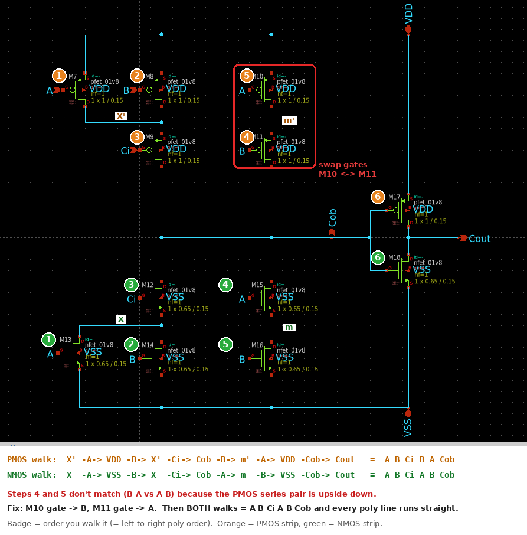 | 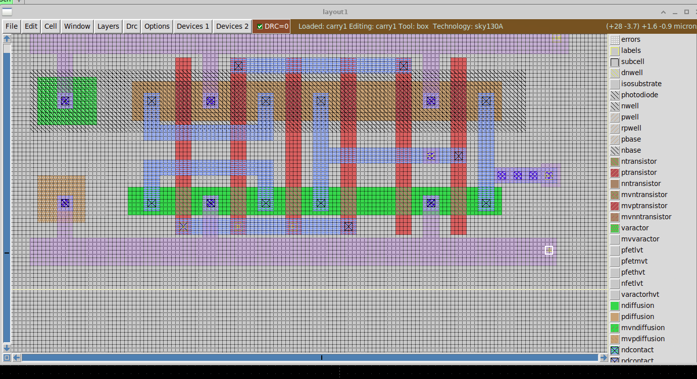 | 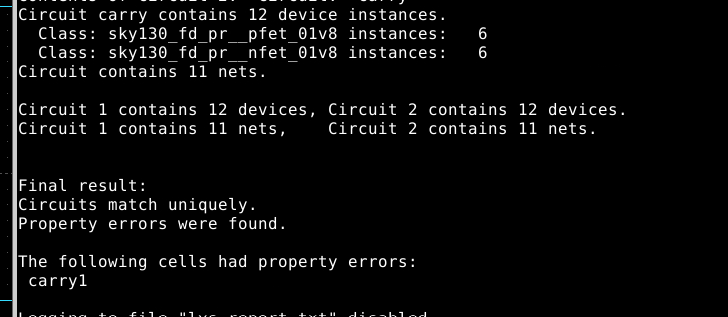 |

#### pp_cell: the full tile
The three leaf cells are abutted so the VDD/VSS rails run straight through, then wired at the top level: `pp` in locali, `Cob` as a metal2 jumper, and the tile ports (`a_i`, `b_j`, `s_in`, `c_in`, `C_out`, `S_out`) as metal2/metal3 stubs on the tile edges so 64 tiles can snap together into `mult8`.

**LVS note:** every transistor and every net matches (34/34, 23/23). netgen pairs `a_i` ↔ `b_j` swapped; both only drive the inputs of the AND gate, and a·b = b·a, so the function is identical.

Remaining property note on all cells: drawn L = 0.4 µm vs 0.15 µm in the schematic (topology matches).

### ✅ mult8: all 64 tiles wired, 147 = 147 nets

8 rows stacked on a 1688-unit pitch (7 × `row_1_test_label_fix` + `row_7`), plus the P15 `nand2`:

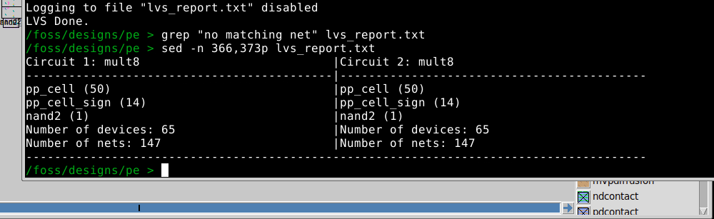

| Wiring | How |
|---|---|
| sout → sin between rows (49) | metal2 jumpers, one per tile, shifted one tile right |
| cout → sin7 between rows (6) | metal2 drop + via1 onto the sin7 pad |
| a7 … a0 (8 buses × 8 rows) | vertical metal2 just left of each a pin + metal1/metal2 jog at the top of every row (dodges the in-row metal3 carry wires) |
| VDD / VSS | metal4 straps with via stacks onto every row's metal1 rails |
| row 0 sins → VSS, row 1 sin7 → VDD | Baugh-Wooley "+0" and "+1" constants |
| P0 … P15 | sout0 of every row + row_7's sout1..7, P15 = NOT(row_7 cout) via nand2 with A = B |


**Net scoreboard (layout vs schematic):** 225 → 217 (power buses) → 210 (a7 bus) → 161 (all a-buses) → 156 (cout drops) → 149 (row 0 sin bus) → **147 = 147**. Every extra net was traced to a specific missing wire before fixing it: `grep "no matching net" lvs_report.txt` → `goto <net>` in Magic → fix.

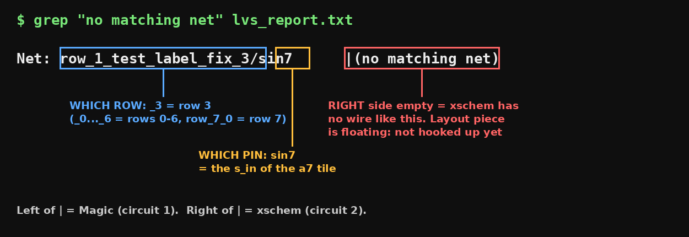

**Still open:** netgen reports "Top level cell failed pin matching" because b0–b7, VDD and VSS have no labels/ports yet. With 8 identical-looking b nets (7 pp + 1 sign tile each), netgen can't tell which row is which without names, so it pairs some of them wrong. That's a labeling task, not a wiring bug. Size property errors (layout L = 0.4 µm vs schematic 0.15 µm) also remain.

#### The pp_and2 bug full-chip LVS found
`pp_cell` had matched LVS on its own earlier, but the full mult8 run flagged the AND gate inside every `pp_cell`: the NAND's output contact sat *between* the two series nfets and the left end of the ndiff strip had no contact, so nfet a went nowhere (a floating node with one connection). Moving the output contact to the left end turned the pull-down back into a real series stack and fixed all 56 pp tiles at once.

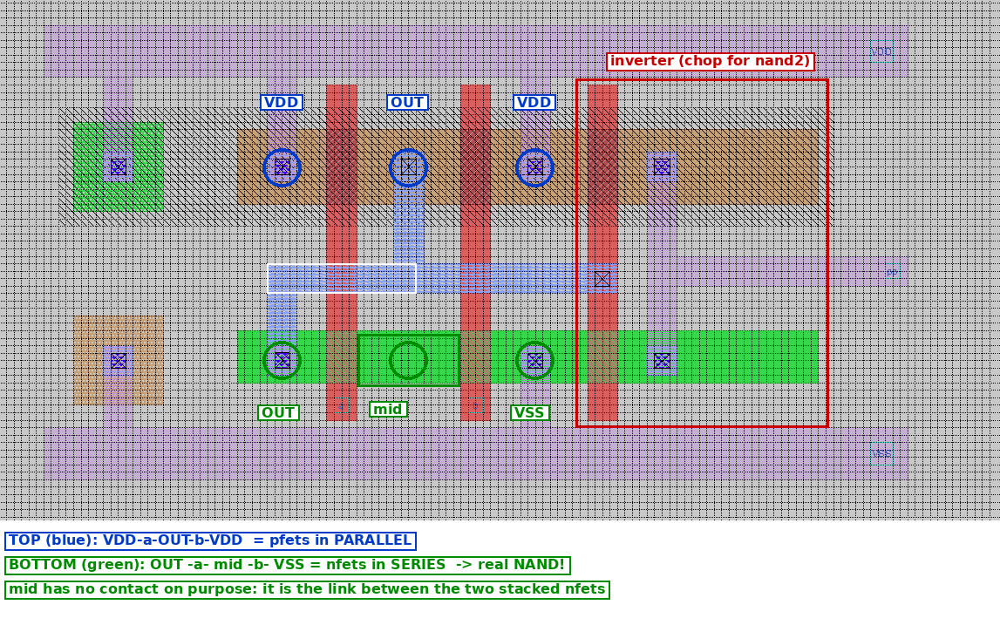

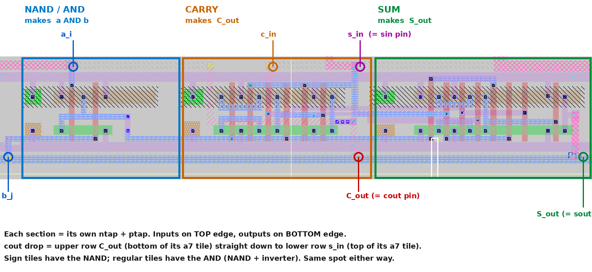


### ✅ The building blocks, in silicon

**pp_cell: the tile everything is built from.** A partial-product AND (a·b), a mirror-adder carry and a mirror-adder sum, abutted into one 34-transistor tile. 50 of these + 14 sign tiles make the multiplier.

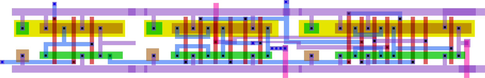

**mult8: signed 8×8 Baugh-Wooley multiplier.** 8 rows of 8 tiles + a nand2 for P15, 2,152 transistors, every inter-row wire hand-routed.

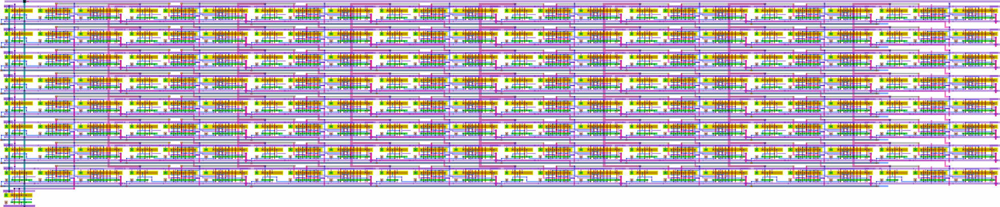

**pe_reg: 8-bit pass-along register.** 8 sky130 `dfxbp` flip-flops with one metal3 clock line. Each flop: D on metal2 up top, Q on metal2 down below, clk via-stacked to metal3. LVS: *Circuits match uniquely* (8 = 8 devices, 27 = 27 nets).

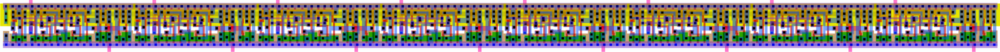

**acc20: 20-bit accumulator.** One `acc_slice` per bit (nor2 for clear + full adder + flip-flop), 20 slices stacked so the carry ripples straight up. LVS: *Circuits match uniquely*.

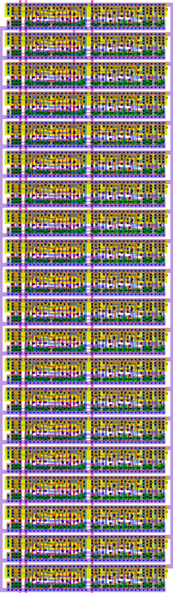

### ✅ pe_cell: one MAC processing element, 68 = 68 devices, 185 = 185 nets

`reg_a` on top feeds the a inputs, `reg_b` (rotated 90°) on the left feeds the b inputs, mult8 in the middle, acc20 (flipped so ACC0 sits next to P0) on the right.

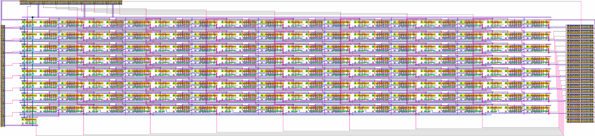

| Connection | Route |
|---|---|
| reg_a q[7:0] → mult8 a7..a0 | metal2 down, 8 metal3 lanes across, metal2 drop onto each a-bus |
| reg_b q[7:0] → mult8 b0..b7 | metal2 with a small jog (8.74 µm register pitch vs 8.44 µm row pitch), via1 onto the b net's metal1 |
| mult8 P0..P15 → acc20 | metal3 horizontals, metal2 jogs in the gap; P0 is one straight line |
| clk | one metal3 line tying reg_a, reg_b and acc20 |

Design decision found by LVS: the first schematic fed mult8 from the register **inputs** (d); the layout feeds it from the register **outputs** (q). Both are valid systolic PEs; q was kept (registered multiplier inputs, same 1-clock delay on a and b so the wavefront still lines up) and the schematic was relabeled to match.

### ✅ array4x4: 16 PEs, 1088 = 1088 devices, 2708 = 2708 nets


| Signal | Route |
|---|---|
| a chain (`ah`, left → right, 96 wires) | a_out track extended east on m3 → up the column gap on m4 → across the next PE's top on m3 → m2 drop onto its a pins |
| b chain (`bv`, top → bottom, 96 wires) | m4 hop over reg_b → down the column gap on m4 (alternating lane sets on even/odd rows so stacked links never overlap) → m3 into the lower PE's b pins |
| clk, clr, VDD, VSS | m3 rails along the top of every PE row, tied together by four m4 spines on the left |
| pins | ah00–ah30 (a in), bv00–bv03 (b in), c00[19:0]–c33[19:0], clk, clr, VDD, VSS |

Rule of thumb that made the big routes possible: **one direction per layer** (m3 horizontal, m4 vertical, m2 short drops), so wires only ever cross on different layers. Every route was checked by script against the flattened geometry of all 16 PEs (spacing per layer, via-on-via, via enclosure) before it was written, and the checker was proven by injecting a deliberate short.

**Size:** each PE slot is about **429 × 104 µm**, the full core **1715.24 × 412.85 µm ≈ 0.71 mm²** (measured with Magic `box`).

**Both pe_cell and array4x4** finish with netgen's *"Top level cell failed pin matching"*: every device and net matches, but mult8's grid is so regular that netgen can't tell identical-looking rows apart (`Port matching may fail to disambiguate symmetries`). The W/L property errors are the known L = 0.4 µm (layout) vs 0.15 µm (schematic) mismatch.

### Lessons learned
- **Run the full-chip LVS even if every cell passes alone.** A broken pull-down in `pp_and2` only showed up in the mult8 run.
- **A label never connects anything.** It only names the paint it sits on, in that cell. Wires need real metal and vias.
- **Magic vias are drawn bigger than the cut** (via1 0.26 µm, via2 0.28 µm), and the metal has to extend past them. Most of the DRC errors came from this.
- **One direction per metal layer** (m3 horizontal, m4 vertical) made routing the full array possible without shorts.

## Roadmap

- [x] mult8, acc20, pe_reg schematics + sims
- [x] pe_cell schematic + sim (PASS)
- [x] array4x4 schematic + testbench
- [x] and2 layout: DRC 0, LVS match
- [x] carry (mirror adder) layout: DRC 0, LVS match
- [x] sum (mirror adder) layout: DRC 0, LVS match
- [x] pp_cell tile (and2 + carry + sum): DRC 0, LVS 34/34 devices, 23/23 nets
- [x] pp_cell_sign tile (and2 flattened -> nand2, inverter removed; 32 devices)
- [x] row (1 pp_cell_sign + 7 pp_cell): 270 devices, nets 140 = 140; every pin verified per tile. Known quirk: netgen shuffles a-pin names (AND input order, see note)
- [x] a/b pin-name flag investigated: swapping the and2 inputs in the schematic breaks the match, so the original wiring is correct; the flag is netgen failing to disambiguate the symmetric AND inputs ('Port matching may fail to disambiguate symmetries')
- [x] row_7 (last row, b7: pp_cell at a7 + 7 pp_cell_sign for a6..a0)
- [x] pp_and2 pull-down bug found by full-chip LVS and fixed (all 56 pp tiles)
- [x] nand2 cell (4T) for P15: LVS match
- [x] mult8: 8 rows stacked, all inter-row wiring, a-buses, power, P0..P15: **65 = 65 cells, 147 = 147 nets**
- [x] mult8 labels/ports: b0..b7, VDD, VSS
- [x] acc20 layout (20 acc_slices): LVS match uniquely
- [x] pe_reg layout (8 dfxbp): LVS match uniquely
- [x] pe_cell layout: 68 = 68 devices, 185 = 185 nets
- [x] **array4x4 layout: 1088 = 1088 devices, 2708 = 2708 nets**
- [ ] update schematic sizes to L = 0.4 µm (clears property errors)
- [ ] Verilog model of the full 4×4 array
- [ ] 2×2 array transistor-level sim on a 16 GB machine

---

## Repo layout

```
docs/datasheets/   datasheets + case-study sheets for every block (PDF)
docs/images/       schematics, layouts, annotated sim results
xschem/            schematics (.sch) and symbols (.sym)
magic/             layouts (.mag)
sim/testbenches/   ngspice code blocks for the array testbenches
sim/scripts/       Python generators + behavioural check for the testbenches
lvs/               how to run LVS + reports
```

## Tools

IIC-OSIC-TOOLS (Docker) · sky130A PDK · xschem · ngspice · Magic · netgen

```
sak-pdk sky130A
cd /foss/designs/pe
xschem pe_cell.sch &
magic -d X11 -rcfile $PDK_ROOT/$PDK/libs.tech/magic/sky130A.magicrc pp_and2.mag &
```
